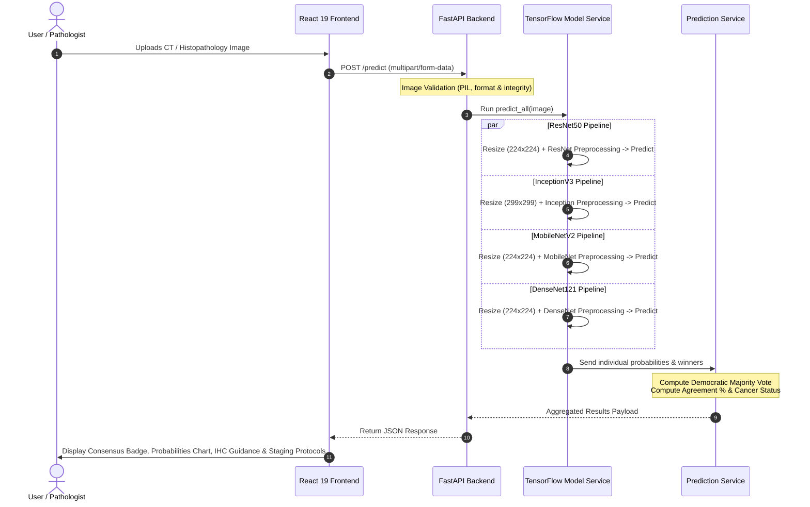

<div align="center">

# 🫁 Lung Cancer Detection: Histopathology & CT Detection System
### *Multi-Architecture Deep Learning Ensemble for Precision Pulmonary Oncology*

[](https://fastapi.tiangolo.com)
[](https://tensorflow.org)
[](https://react.dev)
[](https://vitejs.dev)
[](https://opensource.org/licenses/MIT)

<p align="center">
  <b>An end-to-end clinical decision support platform combining four state-of-the-art Convolutional Neural Networks (CNNs) into a democratic voting ensemble for automated lung cancer subtyping and malignancy assessment.</b>
</p>

[Key Features](#-key-features) • [The Problem It Solves](#-the-problem-it-solves) • [How It Works](#-how-it-works) • [CNN in This Project](#-how-cnn-is-used-in-this-project) • [Model Benchmarks](#-model-benchmarks) • [System Architecture](#-system-architecture) • [Getting Started](#-getting-started) • [API Reference](#-api-reference)

---

</div>

## 📌 Project Overview

**Lung Cancer Detection** is a production-ready artificial intelligence application engineered for rapid detection, classification, and subtype stratification of thoracic images (Histopathology biopsy slides and Chest CT scans). 

The platform concurrent-evaluates pulmonary tissue across four independent deep Convolutional Neural Network architectures (**ResNet50**, **MobileNetV2**, **InceptionV3**, and **DenseNet121**) and synthesizes their predictions via **democratic majority voting**.

### Target Diagnostic Classes:
The system differentiates between four histological categories:
1. **Adenocarcinoma (LUAD)**: Non-Small Cell Lung Cancer originating in peripheral glandular tissue.
2. **Squamous Cell Carcinoma (LUSC)**: Non-Small Cell Lung Cancer arising centrally in the bronchial airways.
3. **Large Cell Carcinoma (LCC)**: Aggressive, undifferentiated Non-Small Cell Lung Cancer.
4. **Normal Lung Tissue**: Healthy, non-neoplastic pulmonary parenchyma.

---

## 🎯 The Problem It Solves

Lung cancer remains the **leading cause of cancer-related mortality globally**, accounting for approximately **1.8 million deaths annually**. The critical clinical challenges include:

| Clinical Challenge | How Lung Cancer Detection Solves It |
| :--- | :--- |
| **Late-Stage Discovery** | Lung cancer is predominantly asymptomatic during early phases. Automated computer-aided triage assists clinicians in rapidly detecting minute neoplastic changes before distant metastasis occurs. |
| **Histological Overlap in Subtypes** | Non-Small Cell Lung Cancer (NSCLC) subtypes (adenocarcinoma, squamous cell, and large cell) can share ambiguous architectural features on standard H&E stains. Lung Cancer Detection extracts multi-scale cellular textures to stratify subtypes. |
| **Drastically Different Treatment Regimens** | Lung cancer subtypes require distinct clinical strategies: Adenocarcinomas are checked for actionable driver mutations (EGFR, ALK, ROS1) for targeted TKI therapies, whereas anti-angiogenics (e.g., Bevacizumab) are contraindicated in Squamous Cell Carcinoma due to fatal hemoptysis risks. Proper identification is vital. |
| **Pathologist Workload & Diagnostic Variability** | Pathologists face increasing specimen volume with high inter-observer variability in borderline cases. Lung Cancer Detection acts as a **second reader**, providing objective probability distributions and flagging discordance. |
| **Single-Model Failure Points** | Relying on a single AI model poses risks of false-positive hallucinations or architecture-specific inductive blind spots. Our **4-model ensemble** computes a quantifiable **concordance rate (50% – 100%)** to gauge algorithmic certainty. |

---

## 🔬 How CNN is Used in This Project

### 1. Why Convolutional Neural Networks (CNNs)?
Traditional machine learning methods depend on manual feature engineering (e.g., Haralick texture features, cell count thresholds, or handcrafted contour filters), which struggle to capture the complex spatial heterogeneity of pulmonary tissue. 

**Convolutional Neural Networks (CNNs)** automatically learn an end-to-end hierarchical representation directly from raw pixel matrices:
- **Low-Level Layers:** Detect fundamental edges, cell membranes, color gradients, and contrast boundaries.
- **Mid-Level Layers:** Extract tissue textures, nuclear pleomorphism, glandular contours, and chromatin distribution.
- **High-Level Layers:** Recognize complex pathological formations such as keratin pearls, acinar/lepidic patterns, or solid polygonal tumor cell nests.

```
Input Image (RGB)
      │
      ▼
┌──────────────┐     ┌──────────────┐     ┌──────────────┐     ┌──────────────────────┐
│ Conv + ReLU  │ ──► │ Pooling Layer│ ──► │ Deeper Convs │ ──► │ Global Avg Pooling   │ ──► Softmax Probabilities
│ (Edges/Lines)│     │(Downsampling)│     │(Tissue & Atypia)   │(Feature Flattening)  │     (4 Classes)
└──────────────┘     └──────────────┘     └──────────────┘     └──────────────────────┘
```

---

### 2. The 4 CNN Architectures & Their Specialized Roles

Rather than relying on a single neural network, Lung Cancer Detection leverages four distinct CNN paradigms, each chosen for its complementary spatial feature-learning methodology:

```
                                ┌────────────────────────────────────────────────────────┐
                                │                    Input Image                         │
                                └──────────────────────────┬─────────────────────────────┘
                                                           │
              ┌─────────────────────────┬──────────────────┴──────────────┬─────────────────────────┐
              ▼                         ▼                                 ▼                         ▼
      ┌───────────────┐         ┌───────────────┐                 ┌───────────────┐         ┌───────────────┐
      │   ResNet50    │         │  InceptionV3  │                 │  MobileNetV2  │         │  DenseNet121  │
      ├───────────────┤         ├───────────────┤                 ├───────────────┤         ├───────────────┤
      │ Residual Skip │         │  Multi-Scale  │                 │   Inverted    │         │  Dense Layer  │
      │  Connections  │         │ Factorized    │                 │  Residuals &  │         │ Concatenation │
      │  (50 Layers)  │         │ Convolutions  │                 │  Bottlenecks  │         │  (121 Layers) │
      └───────┬───────┘         └───────┬───────┘                 └───────┬───────┘         └───────┬───────┘
              │                         │                                 │                         │
              └─────────────────────────┼─────────────────────────────────┴─────────────────────────┘
                                        ▼
                      ┌────────────────────────────────────┐
                      │    Democratic Majority Voting      │
                      │  Consensus & Concordance Metric    │
                      └────────────────────────────────────┘
```

#### A. ResNet50 (Deep Residual Network)
- **Architecture Philosophy:** Introduces identity shortcut connections ($F(x) + x$) that bypass intermediate layers.
- **Why It Matters for Lung Cancer:** As neural networks grow deeper, gradient vanishing hampers weight updates. ResNet's residual formulation allows stable optimization across 50 deep layers, learning nuanced, fine-grained cellular atypia without saturation.
- **Performance in Project:** **Top performing model** with **84.4% Accuracy** and **84.7% Precision**.

#### B. InceptionV3 (Multi-Scale Factorized Convolutions)
- **Architecture Philosophy:** Employs parallel convolutional filters of diverse sizes ($1\times1$, $3\times3$, $5\times5$) combined with asymmetric factorizations ($1\times n$ and $n\times 1$).
- **Why It Matters for Lung Cancer:** Tumors manifest across diverse spatial scales—from macroscopic tumor cavitations down to microscopic individual nucleoli. InceptionV3 processes both simultaneously on high-resolution ($299\times299$) inputs.
- **Performance in Project:** **71.1% Accuracy** and **73.9% Precision**.

#### C. MobileNetV2 (Inverted Residuals & Linear Bottlenecks)
- **Architecture Philosophy:** Replaces standard convolutions with **Depthwise Separable Convolutions** (depthwise spatial filtering followed by $1\times1$ pointwise channel projection) and linear bottlenecks.
- **Why It Matters for Lung Cancer:** Drastically slashes computation (FLOPs) and parameter size (~25MB), demonstrating how clinical AI can run on point-of-care mobile diagnostic carts and low-power hospital workstations.
- **Performance in Project:** **67.6% Accuracy** and **71.8% Precision**.

#### D. DenseNet121 (Densely Connected Convolutional Network)
- **Architecture Philosophy:** Connects every layer to every subsequent layer in a feed-forward fashion ($x_l = H_l([x_0, x_1, \dots, x_{l-1}])$).
- **Why It Matters for Lung Cancer:** Directly reuses feature maps from earlier receptive fields, reducing redundant parameters while facilitating gradient propagation across histological boundaries.
- **Performance in Project:** **56.5% Accuracy** and **67.0% Precision**.

---

## 📊 Model Benchmarks & Comparison

All four models were trained, fine-tuned, and benchmarked on thoracic imaging datasets across the 4 diagnostic categories:

| Model Architecture | Input Resolution | Parameter Footprint | Accuracy | Precision | Recall | F1-Score | Key Strength |
| :--- | :---: | :---: | :---: | :---: | :---: | :--- |
| **ResNet50** 🏆 | $224 \times 224$ | ~235 MB | **84.44%** | **84.69%** | **84.44%** | **84.37%** | Dominant feature representation via skip connections |
| **InceptionV3** | $299 \times 299$ | ~199 MB | **71.11%** | **73.87%** | **71.11%** | **69.89%** | Multi-scale receptive fields for dual micro/macro analysis |
| **MobileNetV2** | $224 \times 224$ | **~25 MB** | **67.62%** | **71.82%** | **67.62%** | **67.45%** | Ultra-lightweight; ideal for edge and point-of-care devices |
| **DenseNet121** | $224 \times 224$ | ~54 MB | **56.51%** | **66.96%** | **56.51%** | **51.37%** | Maximum feature reuse through continuous concatenation |

---

## ⚙️ How It Works (End-to-End Pipeline)



1. **Image Ingestion & Preprocessing:**
   - The user uploads an image via drag-and-drop.
   - The FastAPI backend validates image headers and opens it via Pillow.
   - Custom preprocessing pipelines dynamically resize the image to the exact target geometry ($224\times224$ or $299\times299$) and apply model-specific normalization (zero-centering, scaling to $[-1, 1]$ or ImageNet normalization).
2. **Concurrent Model Inference:**
   - Pre-loaded weights in `.keras` format execute inference across all four models in parallel memory.
   - Each model outputs a raw probability distribution across `[adenocarcinoma, large_cell_carcinoma, normal, squamous_cell_carcinoma]`.
3. **Ensemble Aggregation & Voting:**
   - Predictions are synthesized using a democratic voting algorithm:
     $$\text{Final Prediction} = \operatorname{mode}(\hat{y}_{\text{ResNet}}, \hat{y}_{\text{Inception}}, \hat{y}_{\text{MobileNet}}, \hat{y}_{\text{DenseNet}})$$
   - The **Agreement / Concordance Metric** is calculated:
     $$\text{Concordance} = \frac{\text{Votes for Majority Class}}{\text{Total Models (4)}} \times 100\%$$
   - Cancer classification status:
     $$\text{is\_cancer} = (\text{Majority Prediction} \neq \text{"normal"})$$
4. **Clinical Presentation & Guidance:**
   - The React interface visualizes:
     - **Consensus Banner:** 100% (Unanimous), 75% (Strong Majority), or 50% (Discordant / Review Required).
     - **Comparative Bar Chart:** Class probabilities per model or ensemble-averaged distribution.
     - **Pathological Dossier:** Biological origin, clinical significance, and recommended **Immunohistochemistry (IHC)** panels (e.g., TTF-1, p40, Napsin A) and staging next steps.

---

## 🏛️ System Architecture & File Structure

```
lung_cancer_ai/
├── backend/                              # Backend Service (Python / FastAPI)
│   ├── main.py                           # API routes, CORS setup, and lifecycle handlers
│   ├── requirements.txt                  # Python package specifications
│   ├── models/                           # Serialized deep learning models (.keras)
│   │   ├── resnet50_best.keras           # ResNet50 trained weights
│   │   ├── inceptionv3_best.keras        # InceptionV3 trained weights
│   │   ├── mobilenetv2_best.keras        # MobileNetV2 trained weights
│   │   └── densenet121_best.keras        # DenseNet121 trained weights
│   └── services/
│       ├── model_service.py              # Model loading, image scaling & inference execution
│       └── prediction_service.py         # Majority voting, agreement scoring & response formatting
├── frontend/                             # User Interface (React 19 / Vite)
│   ├── src/
│   │   ├── App.jsx                       # Main application: Diagnostics, Charts, Pathology Library
│   │   ├── index.css                     # Premium dark-mode glassmorphic design system
│   │   └── main.jsx                      # React DOM root mounting
│   ├── package.json                      # Frontend dependencies (Recharts, Lucide, Axios)
│   └── vite.config.js                    # Vite bundler configuration
├── lung_cancer_project/                  # Benchmark artifacts & dataset configurations
│   ├── class_info.json                   # Class indices & input spatial dimensions
│   ├── model_comparison.csv             # Quantitative metrics (Acc, Precision, Recall, F1)
│   └── model_results.json                # JSON benchmark output
└── README.md                             # Comprehensive project documentation
```

---

## 🚀 Getting Started

### Prerequisites
- **Python:** 3.10 or higher
- **Node.js:** 18.0 or higher
- **npm:** 9.0 or higher

---

### Step 1: Backend Setup (FastAPI & TensorFlow)

1. Clone or open the repository root:
   ```bash
   cd "lung cancer ai"
   ```

2. Create and activate a Python virtual environment:
   ```bash
   # On macOS/Linux:
   python3 -m venv venv
   source venv/bin/activate

   # On Windows:
   python -m venv venv
   venv\Scripts\activate
   ```

3. Install the required Python dependencies:
   ```bash
   pip install -r backend/requirements.txt
   ```

4. Verify that the trained `.keras` model weights are present in `backend/models/`:
   - `resnet50_best.keras`
   - `inceptionv3_best.keras`
   - `mobilenetv2_best.keras`
   - `densenet121_best.keras`

5. Start the FastAPI backend server:
   ```bash
   python -m uvicorn backend.main:app --host 0.0.0.0 --port 8001 --reload
   ```
   > ℹ️ The backend initializes and loads all 4 models into memory on startup. You should see `Loaded ResNet50 successfully`, etc., in the console.

---

### Step 2: Frontend Setup (React & Vite)

1. Open a new terminal tab and navigate into the `frontend` directory:
   ```bash
   cd frontend
   ```

2. Install Node.js dependencies:
   ```bash
   npm install
   ```

3. Start the Vite development server:
   ```bash
   npm run dev
   ```

4. Launch your browser and navigate to:
   ```
   http://localhost:5173
   ```

---

## 📡 API Reference

### 1. Health & Readiness Check
Inspects backend status and verifies if all neural network weights are loaded into memory.

- **Endpoint:** `GET /health`
- **Response `200 OK`:**
  ```json
  {
    "status": "healthy",
    "models_loaded": true
  }
  ```

---

### 2. Multi-Model Inference & Ensemble Voting
Submits a histological or CT slice for 4-model analysis.

- **Endpoint:** `POST /predict`
- **Content-Type:** `multipart/form-data`
- **Parameters:**
  - `file`: Image file (`JPEG`, `PNG`, `WEBP`, or `TIFF`)

- **Response `200 OK`:**
  ```json
  {
    "models": {
      "ResNet50": {
        "prediction": "adenocarcinoma",
        "confidence": 0.9412,
        "probabilities": {
          "adenocarcinoma": 0.9412,
          "large_cell_carcinoma": 0.0315,
          "normal": 0.0051,
          "squamous_cell_carcinoma": 0.0222
        }
      },
      "InceptionV3": {
        "prediction": "adenocarcinoma",
        "confidence": 0.8874,
        "probabilities": {
          "adenocarcinoma": 0.8874,
          "large_cell_carcinoma": 0.0612,
          "normal": 0.0089,
          "squamous_cell_carcinoma": 0.0425
        }
      },
      "MobileNetV2": {
        "prediction": "adenocarcinoma",
        "confidence": 0.8123,
        "probabilities": {
          "adenocarcinoma": 0.8123,
          "large_cell_carcinoma": 0.1042,
          "normal": 0.0211,
          "squamous_cell_carcinoma": 0.0624
        }
      },
      "DenseNet121": {
        "prediction": "large_cell_carcinoma",
        "confidence": 0.5210,
        "probabilities": {
          "adenocarcinoma": 0.4120,
          "large_cell_carcinoma": 0.5210,
          "normal": 0.0120,
          "squamous_cell_carcinoma": 0.0550
        }
      }
    },
    "majority_vote": {
      "prediction": "adenocarcinoma",
      "votes": 3,
      "total_models": 4,
      "agreement": 0.75
    },
    "is_cancer": true
  }
  ```

---

## 📚 Histopathological Reference Guide

For each detected condition, Lung Cancer Detection links the prediction to the appropriate clinical reference protocol:

```
┌────────────────────────┬─────────────────────────────┬──────────────────────────────┬───────────────────────────────┐
│ Histological Subtype   │ Primary Anatomical Origin   │ Key Microscopic Features     │ Confirmatory Diagnostic Steps │
├────────────────────────┼─────────────────────────────┼──────────────────────────────┼───────────────────────────────┤
│ Adenocarcinoma         │ Peripheral alveolar &       │ Glandular / acinar formation,│ IHC: TTF-1 (+), Napsin A (+), │
│ (LUAD)                 │ bronchiolar epithelial cells│ mucin secretion, papillary   │ p40 (-). Test for EGFR, ALK,  │
│                        │                             │ growth, lepidic patterns     │ ROS1, and PD-L1 mutations.    │
├────────────────────────┼─────────────────────────────┼──────────────────────────────┼───────────────────────────────┤
│ Squamous Cell          │ Central bronchial airway    │ Keratin pearls, intercellular│ IHC: p40 (+), p63 (+),        │
│ Carcinoma (LUSC)       │ epithelium (proximal)       │ bridges, individual cell     │ CK5/6 (+), TTF-1 (-).         │
│                        │                             │ keratinization, necrosis     │ Bronchoscopy biopsy.          │
├────────────────────────┼─────────────────────────────┼──────────────────────────────┼───────────────────────────────┤
│ Large Cell Carcinoma   │ Transformed undifferentiated│ Sheets of large polygonal    │ Broad IHC panel to rule out   │
│ (LCC)                  │ pulmonary epithelium        │ cells, vesicular nuclei,     │ poorly differentiated LUAD or │
│                        │                             │ prominent nucleoli           │ neuroendocrine carcinoma.     │
├────────────────────────┼─────────────────────────────┼──────────────────────────────┼───────────────────────────────┤
│ Normal Tissue          │ Healthy respiratory         │ Preserved alveolar septa,    │ Routine screening; correlate  │
│ (Benign)               │ parenchyma                  │ thin Type I & II pneumocytes,│ with thoracic radiology for   │
│                        │                             │ clear alveolar airspace      │ clinical symptoms.            │
└────────────────────────┴─────────────────────────────┴──────────────────────────────┴───────────────────────────────┘
```

---

## 🛡️ Concordance & Decision Framework

The web interface categorizes model agreement into three clear clinical tiers:

- 🟢 **100% Concordance (4/4 Models):** **Unanimous Consensus.** All four neural backbones derived convergent spatial representations. Demonstrates high algorithmic reliability.
- 🟡 **75% Concordance (3/4 Models):** **Strong Majority.** Three models agree while one diverges. Often seen in poorly differentiated tumors or tissue with borderline morphological characteristics.
- 🔴 **50% Concordance (2/4 Models):** **Split / Discordant.** Indication of high cellular heterogeneity, mixed adenosquamous features, or inadequate slide resolution. Immediate human review and IHC staining required.

---

## ⚠️ Academic & Medical Disclaimer

> **IMPORTANT CLINICAL NOTICE:**  
> **Lung Cancer Detection** is an academic research and decision-support prototype designed solely for educational, investigative, and workflow enhancement purposes. It is **not** cleared by the FDA or CE-marked as a primary medical diagnostic device. Neural network inferences must **never** replace professional judgment or serve as the solitary basis for surgical, chemotherapeutic, or radiological treatment planning. All diagnostic findings must be corroborated by a board-certified pathologist, thoracic radiologist, and comprehensive clinical immunohistochemistry.

---

## 📄 License

This project is licensed under the [MIT License](LICENSE).
